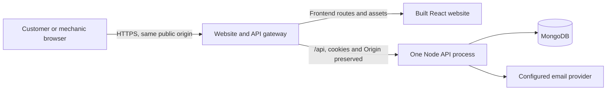

# Production launch preparation

## Readiness and approval

This runbook prepares a deployment. It does not authorize a purchase, publish a site, send live customer email, or confirm unknown shop policies. Passing repository tests is evidence for the tested code, not proof that an actual HTTPS host, SMTP account, backup, or business schedule is ready.

Before accepting customer bookings, Edward must approve the public contact details, actual services and estimates, hours/breaks/closures, simultaneous capacity, and cancellation policy. Privacy and policy drafts must match the selected providers and operating practices. Keep unresolved details as launch blockers rather than guessing them.

Run `npm run check:launch` using the intended runtime environment. This offline configuration check does not load `.env`, connect to a database, send email, verify TLS, or prove a successful backup/restore. Resolve its configuration blockers and separately complete its unverified operational items. Do not paste credentials into issues or chat.

## Hosting shape

The current application expects one long-running Node API process:



| Arrangement | Required configuration |
| --- | --- |
| One Node host for frontend and API | Build the frontend, set `SERVE_FRONTEND=true`, terminate public HTTPS at a trusted proxy, and forward requests to Node. The process serves built assets and supported SPA routes from `dist`. |
| Static frontend host such as Vercel plus a Node API host | Keep the API running separately and forward **all** public `/api` paths to it while preserving the path, methods, Origin, Set-Cookie, cache-control, and referrer-policy headers. Serve the React app for frontend deep links. |

Both arrangements use one browser-visible origin. Do not weaken SameSite/CSRF protections or add wildcard credentialed CORS to work around an unrelated API domain. Do not rewrite API failures or missing JavaScript/CSS assets to SPA HTML. A frontend-only Vercel build cannot run the existing Express listener or periodic email retry worker.

Use a hosting plan that permits the intended commercial use. Review current provider pricing and privacy agreements when selecting providers; no provider account or paid plan is created by this repository.

## Single-host setup on a Node/container provider

Render and Railway are possible examples, not selected or purchased services. Choose an always-running paid Node/container service with one replica, no scale-to-zero, enough termination grace, and verified outbound SMTP support. Confirm current commercial-use terms, region, price, resource limits, backup options, and data-processing terms before purchase.

An operator can prepare either provider as follows without enabling deployment yet:

1. Connect the reviewed repository/branch and select the repository-root Dockerfile. Keep automatic deployment off until the complete launch review is approved. Do not set a `server` root directory: the build needs root frontend files and `shared`.
2. Use one replica/process, the normal container start command, and readiness path `/api/health`. Node listens on the provider's `PORT` and `HOST=0.0.0.0`; the platform supplies public HTTPS.
3. Add the private runtime settings below in the host's secret store. Keep `SERVE_FRONTEND=true` for the combined image. MongoDB must be reachable from the service through the reviewed database/network configuration.
4. Obtain the assigned HTTPS URL, set `PUBLIC_WEBSITE_ORIGIN` to that exact origin, and configure any custom domain/TLS before issuing management links. Verify sender/reply and staff mailboxes before enabling real delivery.
5. Check the actual trusted reverse-proxy networks and graceful-stop timeout. Do not enable autoscaling, multiple workers, or overlapping rolling deployments with the existing dispatcher design.
6. Run the controlled verification below before opening bookings. A provider dashboard reporting a successful build is not a completed application launch check.

For a provider's native Node build instead of Docker, run from the repository root:

```sh
npm ci --include=dev
npm ci --prefix server --omit=dev
npm run build
```

Use `npm start` as the runtime command with the production environment below and `SERVE_FRONTEND=true`. The explicit frontend `--include=dev` installs Vite even when the provider sets `NODE_ENV=production` during its build. Keep all private runtime values out of the frontend build environment and browser bundle.

Do not put deployment tokens, MongoDB credentials, SMTP credentials, or the management key into `vercel.json`, the Dockerfile, GitHub Actions, the public business profile, or browser-exposed `VITE_` variables.

## Process and data constraints

- Run one API replica and one email dispatcher. Clustering/autoscaling can break process-local staff sessions and duplicate email delivery; a shared session/worker-claim design would be a separate implementation.
- Restarts discard staff sessions and require sign-in again. Customer-management sessions remain Mongo-backed, bounded by their grant/session lifetime and the stable external key.
- Keep `APPOINTMENT_MANAGEMENT_SECRET` stable across ordinary deployments. Rotating it deliberately invalidates existing management links and customer sessions; do not regenerate it for every build.
- Email remains at least once: a provider can accept a message before the MongoDB acknowledgement fails, causing a later retry. Already in-flight messages cannot be recalled. See [notification semantics](customer-appointment-management.md#notification-semantics).
- MongoDB persists outside the app container. Follow the [backup and restore runbook](backup-and-restore.md) to preserve appointments and scheduling state consistently. The application container filesystem is not a database backup.

## Runtime configuration

Supply server-only secrets through the host's private environment/secret store.

| Setting | Production requirement |
| --- | --- |
| `NODE_ENV` | `production`; enables secure production cookie behavior. |
| `HOST` | Normally `0.0.0.0` inside a service/container; local development defaults to loopback. Control public ingress at the host/proxy. |
| `PORT` | Host-assigned valid TCP port; default `3001`. Public HTTPS need not expose this internal port. |
| `SERVE_FRONTEND` | `true` for the combined Node deployment, `false` for an API-only backend. Build `dist` first when enabled. |
| `MONGODB_URI` | Private production database connection scoped to the shop database and protected by the provider/network configuration. Never reuse a test connection. |
| `MECHANIC_ADMIN_PASSWORD` | Unique strong staff password stored privately; runtime rejects the example placeholder and passwords below its minimum. |
| `PUBLIC_WEBSITE_ORIGIN` | Exact public HTTPS origin, with no credentials, path, query, or fragment. No production loopback/default URL is generated. |
| `APPOINTMENT_MANAGEMENT_SECRET` | At least 32 cryptographically random bytes encoded as base64/base64url, generated once and stored privately. |
| `SMTP_HOST`, `SMTP_PORT`, `SMTP_USER`, `SMTP_PASS`, `MAIL_FROM`, `MECHANIC_NOTIFICATION_EMAIL` | Reviewed SMTP configuration, sender/reply mailbox, and Edward's notification inbox. Configuration presence alone does not prove delivery. |
| `SHUTDOWN_GRACE_MS` | Default `10000`; supported `1000`–`30000`. Give the host a stop timeout longer than this deadline. |
| `TRUST_PROXY` | Defaults to `false`. If the reviewed topology needs forwarded client IPs, use only the actual trusted proxy IP/CIDR allowlist; blanket trust and hop counts are rejected. |

Configure proxy trust only for the actual trusted proxy networks supported by the runtime. Do not use unrestricted trust or a guessed hop count to accept arbitrary forwarded client IPs. Verify the real proxy chain, client IP handling, login throttling, HTTPS, and Secure cookies before opening bookings.

Configure and test abuse controls at the selected public ingress, including rate limiting for `POST /api/appointments`. Staff login has application throttling; the public booking route does not currently impose a booking-spam quota. Choose limits for the actual shop traffic and trusted client-IP topology, and verify that legitimate submissions receive clear retry behavior. Do not assume the host enables these controls automatically.

Missing or invalid management-link/SMTP settings must retain honest fallback behavior, never fabricate a working link or claim email was delivered. Production launch checks can remain blocked while local development and synthetic tests work normally.

## Portable Docker image

Build from the repository root:

```sh
docker build -t eds-auto-shop:review .
```

The multistage build uses lockfiles, retains only backend production dependencies in the runtime image, excludes `.env` files, runs as the non-root `node` user, and exposes port `3001`. It includes the built frontend for optional same-origin serving. Supply run configuration separately; do not bake credentials into an image.

The image also includes the offline launch-check entrypoint. An operator can validate the intended configuration without starting the API or contacting MongoDB/SMTP:

```sh
docker run --rm --env-file /path/to/private-production-environment \
  --entrypoint node eds-auto-shop:review scripts/check-launch.js --json
```

A successful configuration check still reports `readyForPublicLaunch: false`: live HTTPS/routing, saved business settings, delivery, monitoring, and recovery remain separate operator verifications. With the current unconfirmed public profile, launch blockers are expected.

For a managed build proxy requiring an additional CA, keep TLS verification enabled and provide the public certificate through the optional BuildKit secret:

```sh
docker build --secret id=proxy_ca,src=/path/to/trusted-proxy-ca.pem -t eds-auto-shop:review .
```

The CA exists only during dependency installation and is not retained in the image. Do not disable TLS verification to work around proxy errors.

A reviewed host can start the image using its secret-store integration. For a local staging check behind a trusted HTTPS reverse proxy, an operator can publish only the host loopback port:

```sh
docker run --rm --name eds-auto-shop-review --stop-timeout 35 \
  --env-file /path/to/private-production-environment \
  -p 127.0.0.1:3001:3001 eds-auto-shop:review
```

Internal `HOST=0.0.0.0` lets container ingress reach Node. The external loopback binding above is intended for a local reverse proxy; managed-host ingress must be configured for the selected platform. This is an operator example, not an executed deployment. Do not point an exploratory run at real shop data or live customer mailboxes.

## Health, shutdown, and monitoring

`GET /api/health` is readiness: HTTP 200 with a connected database, HTTP 503 when the database is unavailable or shutdown has begun. It contains no appointment/customer data. The Docker health check uses this endpoint.

`GET /api/health/live` is process liveness. Configure the chosen host's readiness checks, restart policy, external uptime notification, and application error alerting explicitly. Adding endpoints does not provision monitoring or prove that an alert reaches Edward.

SIGTERM/SIGINT stops admission of new work and future queue sweeps, drains supported in-flight work within the deadline, and closes MongoDB. Give the platform enough termination grace. Staff sign in again after deployment; durable appointments and notification intents remain in MongoDB. Do not run former and replacement processes as concurrent dispatchers during a rolling update.

Use fixed failure categories and safe identifiers where necessary in logs. Do not enable body/header logging for passwords, cookies, management exchanges, or appointment forms. Exclude customer fields, emailed bearer fragments, backups, and connection strings from analytics/error-reporting payloads.

## Controlled verification before launch

Use staging or a separately approved controlled production smoke test with synthetic customer details and mailboxes owned by participants. Sending test email or changing actual settings requires operator approval; neither CI nor this runbook executes it automatically.

1. Finish Edward's public-profile, service, policy, scheduling, and capacity review. Keep automation off unless he separately verifies actual hours/capacity and explicitly enables eligible Wiper Blade Replacement automation.
2. Run lint, production build, frontend/API tests, and the complete browser suite. Never point fixtures at production data.
3. Run the offline launch check with intended production settings. Resolve its blockers, then separately verify its operational items.
4. Check actual HTTPS/TLS, same-origin `/api` forwarding, health probes, frontend deep links (`/services`, `/appointment`, `/mechanic`, `/manage-appointment`), API 404 responses, and missing-asset 404 responses.
5. With a controlled mailbox, request a future appointment. Confirm saved status, MongoDB persistence, customer/staff email, U.S. date/time labels, and the management fragment link. Its token must disappear from the visible URL and remain absent from browser persistent storage and ordinary logs.
6. Verify staff sign-in, CSRF rejection, sign-out/back navigation, inactivity expiry, review/decline/cancellation, retained histories, and release of only the cancelled reservation. A lost email does not justify blindly repeating a potentially saved booking.
7. Complete and record a backup/restore drill in an isolated database, an uptime/error alert check, and a compatible code rollback check. Use the restore runbook rather than overwriting live records. A code rollback must still understand the stored catalog/scheduling schema; restoring only one coordination-related collection is unsafe.
8. Reconcile synthetic records and queued test messages explicitly. Begin with a small controlled launch and verify operations before advertising broad availability.

Rescheduling, SMS, payments, and the proposed three-oil-changes-per-hour model remain separate work. Launch preparation does not enable those features or establish a fixed oil-change price.
